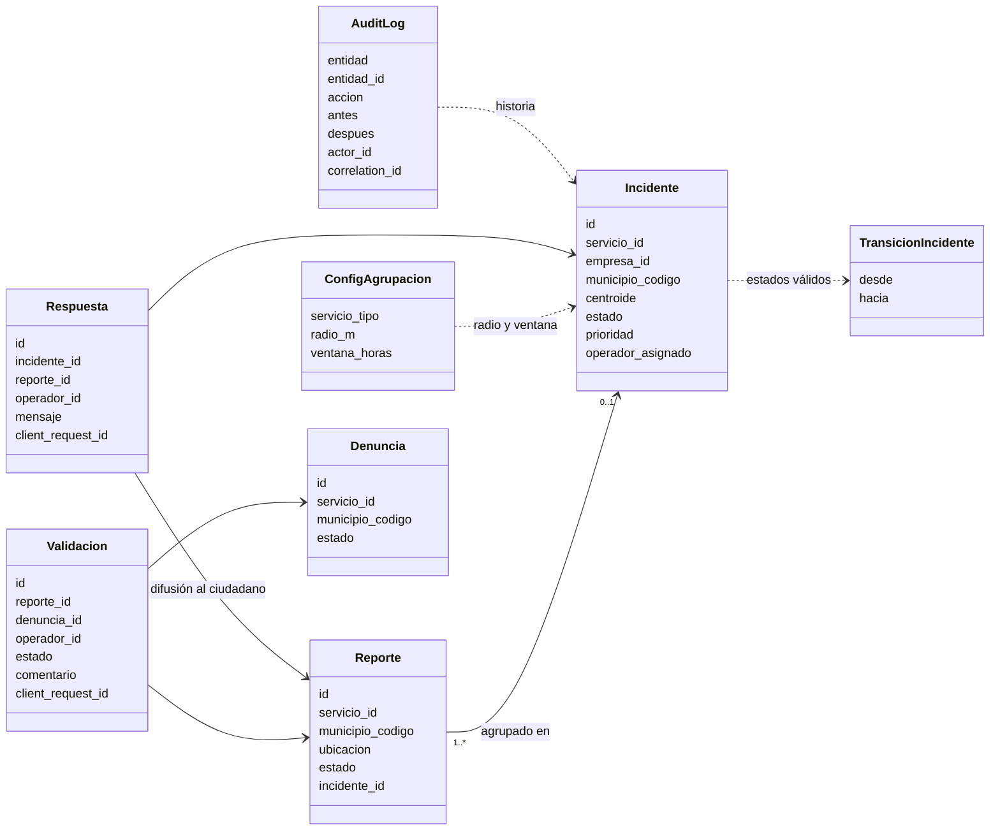

# 5.1 Vista lógica: Módulo de Operación (ampliado)

El Módulo de Operación cubre **validación, priorización, asignación y seguimiento** de incidentes, más la
trazabilidad y la exportación regulatoria. Toda regla vive en la base (PostgreSQL/Supabase); el portal y la
app consumen RPC y vistas.

| Responsabilidad | Elementos |
|---|---|
| Agrupación | `config_agrupacion`, `private.agrupar_pendientes()` (pg_cron, 30 s), `incidentes_cercanos()` |
| Validación (moderación) | `moderar_denuncia()`, `moderar_reporte()`, vista `cola_moderacion` |
| Priorización | `priorizar_incidente()`, `prioridad_sugerida` en `incidente_operacion` |
| Asignación | `asignar_incidente()`, `asignar_empresa_incidente()` (admin) |
| Seguimiento | `cambiar_estado_incidente()` (máquina de estados de P1, req. 20), `responder()` |
| Trazabilidad (req. 19) | `audit_log` (P1), `linea_tiempo_incidente()`, correlation-id |
| Exportación | `exportar_incidentes()` (CSV para SSPD/CRA) |
| Notificación | Broadcast privado `empresa:<id>` / `admin` (`p4_realtime`) |
