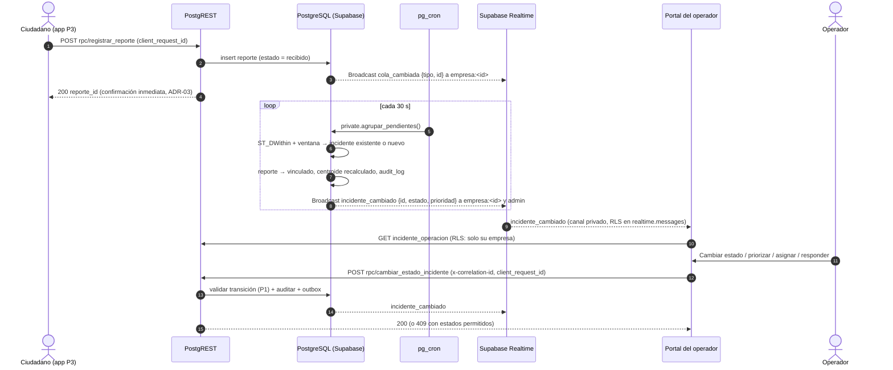

# 5.2 Figura 2: del reporte ciudadano al portal del operador

Notas:
- Los mensajes de Realtime solo llevan identificadores y estado; el portal vuelve a consultar con su RLS.
- El outbox de P1 (`incidente.estado_cambiado`, `reporte.estado_cambiado`) sigue siendo el canal para las
  notificaciones al ciudadano.
