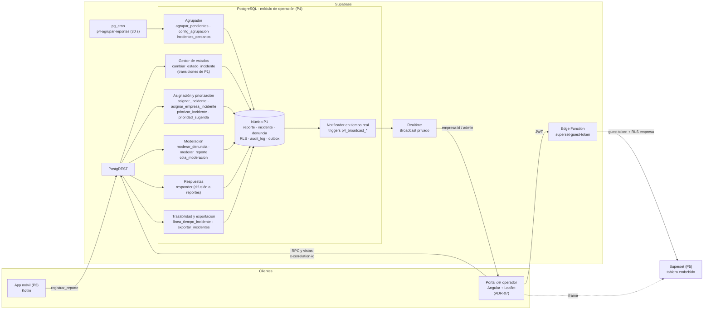

# 6.3 C4 nivel 3: componentes de la gestión de incidentes

| Componente | Tecnología | Responsabilidad |
|---|---|---|
| Agrupador | plpgsql + PostGIS + pg_cron | Vincula reportes a incidentes por servicio, cercanía y tiempo (ADR-03) |
| Gestor de estados | plpgsql | Transiciones válidas con error 409 explicativo (req. 20) |
| Asignación y priorización | plpgsql | Operador responsable, empresa (admin), prioridad 1-5 y sugerida |
| Moderación | plpgsql | Validación atómica de denuncias y reportes con motivo obligatorio al rechazar |
| Respuestas | plpgsql | Mensajes internos o visibles al ciudadano (difusión), idempotentes |
| Trazabilidad y exportación | plpgsql | Línea de tiempo desde `audit_log`; CSV regulatorio auditado (req. 19) |
| Notificador en tiempo real | triggers + `realtime.send` | Avisos mínimos por canal privado de empresa |
| Portal Angular | Angular 21, Leaflet, supabase-js | Interfaz del operador, regulador y admin |
| Edge Function | Deno | Guest token de Superset con RLS por empresa; credenciales solo en entorno |
